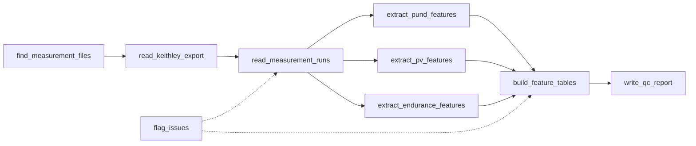

# Mapping the flash-anneal crystallization boundary in HZO

Active-learning campaign to locate the amorphous → crystalline boundary of flash-lamp-annealed
Hf₀.₅Zr₀.₅O₂ thin films in the two-knob process space (flash voltage `V`, pulse time `t`), using a
Gaussian process with a level-set acquisition to spend as few fabricated samples as possible.

The target is **total crystalline fraction**, not phase. The map is therefore monotone in thermal
severity and there is a single boundary to find.

## The question the design is built around

Peak temperature `Tmax(V, t)` is measured (`data/flash_temp_table.csv`). The temperature **trace**
`T(τ)` is not — it is asserted by a pulse shape. Activated kinetics integrate the trace, so that
assertion decides the boundary's geometry:

```
Phi(V, t) = INT exp(-Ea / kB T(tau)) dtau  =  t_eff * exp(-Ea / kB Tmax)
Tb(t2) - Tb(t1) = -theta * ln( t_eff(t2)/t_eff(t1) ),      theta = kB Tmax^2 / Ea ~ 37 K
```

If the effective dwell ignores the commanded pulse width, the tilt is exactly zero and the boundary
is a plain `Tmax` level set. If it tracks the pulse width, it is not. Four candidate cooling laws
span the range, over `t` in `[2.6, 10.1] ms`:

| shape | tail | `t_eff` | tilt |
|---|---|---|---|
| `isoT` | fitted exponential + permanent plateau | independent of `t` | **0.0 °C** |
| `ramp` | empirical two-exponential + plateau | `∝ t + 12.4` | **13.3 °C** |
| `diffusion` | **derived**, `τ^(-1/2)`, no plateau | `∝ 2t` | **49.8 °C** |
| `rect` | bounding case | `= t` | **50.0 °C** |

`diffusion` is the default: a 30 nm stack has negligible heat capacity, so its temperature is
slaved to conduction into the fused-silica substrate, and the Carslaw & Jaeger surface solution has
zero fitted parameters. It depends on `τ` only through `τ/t`, so conduction — having no intrinsic
timescale — makes the effective dwell exactly proportional to the pulse width.

**Nothing measured yet distinguishes these.** One digitized `T(τ)` at two pulse widths would, and
costs no film. The initial design is built to be informative regardless of which is true.

## Repository layout

```
src/physics/          constants.py, thermal_model.py: the measured Tmax table and the cooling laws
src/active_learning/  surrogate.py, acquisition.py: the GP and the level-set acquisition
src/campaign/         plan.py, results.py, reporting.py: the fabrication plan and the sheet the lab fills
src/electrical/       PUND / P-V / endurance exports -> per-capacitor and per-sample feature tables
src/utils/            helpers any package may use (writing and reading CSV tables)
src/design_space.py   the settable (V, t) box
src/paths.py          where the measured data lives
src/run_*.py          entry points; scripts/ holds their shell wrappers
data/                 measured inputs and campaign records (see data/README.md)
tests/                pytest suite, including the Round-2 electrical regression
```

## Quick start

```bash
./setup_venv.sh && source venv/bin/activate
./scripts/run_tests.sh              # the suite
./scripts/run_initial_design.sh     # the initial design plan and the sheet the lab fills in
python src/run_campaign.py          # read results, fit, propose the next batch
./scripts/run_electrical_features.sh 2  # Round 2 exports -> feature tables and QC report
```

## The initial design

The first batch is a set of conditions chosen by the principal investigator, recorded in
`data/flash_plan_initial.csv` with the reason for each condition and the simulated peak-temperature
band attached for reading only. `run_initial_design.py` writes that plan and the blank results sheet
once; `run_initial_design_results.py` validates the filled sheet (every row carries an explicit
status, a blank is never read as zero) and reports coverage, as-fired drift and replicate contrast.
From then on `run_campaign.py` reads the measured results, fits the surrogate and proposes the next
batch in the same format.

## Method

- **Surrogate** — GP on normalized `(V, t)` with Matérn 5/2 ARD and **heteroscedastic** per-point
  noise `σ_n(f) = 0.02 + 0.30 f(1−f)`, peaking at ≈0.095 mid-transition where the film is a phase
  mixture. Squared-exponential paths are analytic and ring across a steep ramp; Matérn 5/2 does not.
- **Acquisition** — level-set entropy on the latent (reducible) variance,
  `a(x) = H(Φ((μ − θ)/s))`, so it targets where new data reduces boundary uncertainty rather than
  where noise is irreducibly high. Predictive-entropy and BALD variants are retained as baselines;
  on current evidence the three are statistically comparable.
- **Batching** — Kriging-believer fantasizing spreads a batch along the contour.
- **Readout** — continuous crystalline fraction; in-loop proxy is permittivity `ε_r`.

## Standing caveats

- **The onset is a prior, not a measurement.** `T_ONSET_C = 380 °C ± 30` comes from logistic fits of
  `2P_r` vs temperature on two datasets that disagree (flash 388 °C, RTA 357 °C), fitted in a
  different voltage box and in different units, using a ferroelectric switch-on indicator rather
  than crystallinity. Reconciling them is open work; until then no result may be stated as "the
  measured onset".
- **`ε_r` is calibrated against `2P_r`,** which is o-phase specific, while the target counts any
  crystalline phase. These agree only if essentially all crystallized material in the box is
  o-phase. One structural check on the highest-`Tmax` sample audits it.
- **The cooling law is unvalidated** (above). The ensemble exists precisely so no result silently
  depends on picking one.

## Electrical features (`src/electrical/`)

Each flashed film is measured on ten or so capacitors with a Keithley 4200A: a PUND train
(`PUND_pris_1e6_RxCy_30um.xls`, pristine run in sheet `Data`, run after 10⁶ cycles in
`Append1`), a single P–V sweep (`PV_...`) and an endurance log (`END_1e6_...`). One round of
those exports becomes `raw_index.csv`, `features_per_capacitor.csv` (one row per capacitor and
state), `features_per_sample.csv` (mean / sd / n / median / MAD per feature, per sample and
state) and a QC page with every capacitor overlaid. Rounds accumulate in
`data/electrical/features/campaign_per_capacitor.csv`, the table the correlation study reads.

The package's files are the steps, in the order `process_round.py` runs them:



`convert_units.py` holds the capacitor geometry and the charge and capacitance conversions the
three extractors share; `flag_issues.py` records the problems found on the way and flags
outlying capacitors.

```bash
./scripts/run_electrical_features.sh 3        # data/electrical/raw/round3 -> features/round3
python src/run_electrical_features.py --help  # the flags behind the wrapper
```

The group's summary sheet is the regression target. Its three columns are reproduced on every
Round-2 sample by `tests/test_electrical_round2.py`:

| group's column | definition | our column |
|---|---|---|
| `Pristine_Psw` | instrument (P − U)/A, rising-ramp integration only | `psw_inst_uc_cm2` |
| `Pristine_Pr` | [Q(V = 0 on the +3 → 0 branch) − (Qmax + Qmin)/2] / A | `pr_uc_cm2` |
| `Pristine_Kappa` | slope of Q against V over 0.8–2.25 V on the +3 → 0 branch × t/(ε₀A) | `kappa_summary` |
| `Pristine_Ec_Pos`, `Pristine_Ec_Neg` (`ML_Summary.xlsx`) | V where the centred charge crosses zero on the first 0 → +3 rise, and on the +3 → −3 fall | `ec_pos_v`, `ec_neg_v` |

The Ec definitions are confirmed against the dotted lines the group's script draws on its Q–V plots
(`Analysis_Plots/PV_RxCy.png`), not against a table: their Ec values exist only for Round 1, whose
raw files we do not have. Where the centred charge never crosses zero on the first rise (a few
linear, non-switching films) `ec_pos_v` is left empty; the group's script reports a value there by
a rule we have not seen.

Column names carry their unit (`_uc_cm2`, `_v`, `_s`, `_a_cm2`, `_c`); the remaining columns are
dimensionless. Names used in the earlier prototype and handoff map as follows.

| prototype | here | meaning |
|---|---|---|
| `Psw`, `Psw_pos`, `Psw_neg` | `psw_uc_cm2`, `psw_pos_uc_cm2`, `psw_neg_uc_cm2` | whole-pulse (rise + plateau + fall) P − U and N − D: switching plus leakage |
| `Psw_inst` | `psw_inst_uc_cm2` | the instrument's ramp-only P − U, the sheet's definition |
| `Psw_plateau_pos/neg` | `psw_plateau_pos_uc_cm2`, `psw_plateau_neg_uc_cm2` | switching that continues on the 1 µs plateau |
| `Pr`, `Pr_summary` | `pr_uc_cm2` | the sheet's Pr, a single centred crossing |
| `Pr_gap` | `pr_gap_uc_cm2` | half the V = 0 gap between the two branches; offset-free, for comparison with Psw on imprinted loops |
| `QO_frac_rawN`, `t_split_rawN_s` | `split_raw_n_dip_fraction_main`, `split_raw_n_dip_t_split_s` | O / T partition of the raw N ramp, dip rule (Round-1 slide) |
| — | `split_raw_n_crossover_*`, `split_raw_n_linear_*` | the same partition under the group's two MATLAB rules (`PeakSplit_dIdt_*.m`); reproduces their scripts on every Round-6 capacitor |

Every split works on the N ramp as programmed, 9.0 to 10.0 µs from the `td`, `trf` and `tp` in
the Settings sheet, as the group's scripts and the Round-1 slide do. The measured voltage lags the
programmed waveform by about 20 ns, so a window detected from V(t) would not match theirs.
| `QO_frac_sub_neg`, `QO_frac_sub_pos` | `split_sub_n_dip_*`, `split_sub_p_dip_*` | partition of the U/D-subtracted switching currents |
| `Vc_pos`, `Vc_neg`, `imprint_PUND`, `Vc_mean` | `peak_pos_coercive_v`, `peak_neg_coercive_v`, `imprint_v`, `vc_mean_v` | voltage at the switching-current peak on each polarity |
| `J_leak_A_cm2` | `j_leak_a_cm2` | median current over the tail of the U and D plateaus |
| `kappa_PUND` | `kappa_pund` | permittivity from the U / D ramp displacement current; reads high on switching films, use `kappa_summary` there |
| `kappa0`, `dkappa_rel` | `kappa0`, `dkappa_rel` | zero-field slope and its change with field |
| `Ec_neg`, `pinching_index` | `ec_neg_v`, `pinching_index` | Ec⁻ above; pinching on the closed negative half-loop |
| `wake_ratio`, `fatigue_ratio`, `cycles_half_wakeup` | `endurance_wake_ratio`, `endurance_fatigue_ratio`, `endurance_cycles_half_wakeup` | from the endurance log, attached to the pristine row; Psw there is the instrument's P − U, as on the group's endurance plots |

Findings (a missing P–V run, a hand-typed file name, a split rule that found no shoulder) travel
on the row they concern in the `issues` column; `has_error` marks rows whose values are lost.
Changing a feature definition changes the golden tables under `tests/data/electrical/golden/`;
`scripts/regenerate_electrical_golden.sh` rebuilds them for review.
